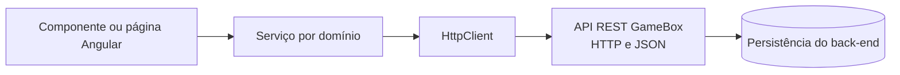

# Integração entre o front-end Angular e o back-end GameBox

## 1. Visão geral

A integração permite que a aplicação Angular consulte e altere dados do GameBox por meio de requisições HTTP. A API usa rotas REST e payloads JSON; o front-end usa `HttpClient` para enviar os dados definidos nos DTOs e receber as respostas tipadas pelos models TypeScript.

O ambiente Angular define a API como `http://localhost:8080`. O OpenAPI fornecido também declara esse endereço como servidor. O script do front-end executa `ng serve`; sem configuração de porta própria, o servidor de desenvolvimento Angular usa normalmente `http://localhost:4200`.



O repositório disponível contém o front-end. A persistência representada no diagrama é conceitual: o OpenAPI não descreve banco de dados.

## 2. Arquitetura no front-end

Estrutura relevante:

```text
src/
├── environments/environments.ts
├── model/api.model.ts
├── services/
│   ├── api-error.ts
│   ├── auth.service.ts
│   ├── avaliacao.service.ts
│   ├── biblioteca.service.ts
│   ├── jogo.service.ts
│   ├── lista-jogos.service.ts
│   ├── metricas.service.ts
│   └── usuario.service.ts
└── app/
    ├── auth.guard.ts
    ├── app.routes.ts
    ├── components/
    └── pages/
```

- **Páginas e componentes** exibem os dados, recolhem entradas e chamam serviços. Os templates e estilos estão em arquivos separados quando há arquivos próprios para a tela.
- **Serviços por domínio** concentram as URLs e chamadas HTTP de usuários, jogos, avaliações, biblioteca, listas e métricas.
- **Models** em `api.model.ts` descrevem requests e responses usados pelo cliente, incluindo `StatusJogos`.
- **AuthService** mantém o usuário atual no estado da aplicação e no `localStorage`.
- **auth.guard** impede a navegação para rotas protegidas quando não há usuário local carregado. Ele não autoriza operações no servidor.
- **api-error.ts** extrai a mensagem de erro da resposta HTTP e fornece mensagens alternativas.
- **environment** centraliza a URL-base da API em `apiUrl`; os serviços concatenam as rotas a essa base.
- **HttpClient** é fornecido globalmente em `app.config.ts` por `provideHttpClient()`.

As rotas de tela são `/home`, `/games/:id`, `/profile`, `/admin` e `/login`. O guard está aplicado a `/profile` e `/admin`.

## 3. Configuração e execução

### Front-end

Na raiz deste projeto:

```bash
npm install
npm start
```

O script `start` executa `ng serve`. A configuração atual não fixa uma porta no comando; o Angular CLI usa por padrão a porta 4200. A API é configurada em `src/environments/environments.ts` como `http://localhost:8080`.

### Back-end

O `openapi.json` declara `http://localhost:8080` como URL do servidor. O código e as instruções de inicialização do back-end não estão neste repositório; por isso, o comando para iniciá-lo não pode ser confirmado aqui. É necessário iniciar o serviço de back-end separadamente nesse endereço para executar os fluxos integrados.

### CORS e banco

Como o front-end em `localhost:4200` e a API em `localhost:8080` têm origens diferentes, o navegador exige uma configuração CORS compatível no servidor. O OpenAPI não documenta a origem permitida nem as regras CORS; elas não podem ser confirmadas pelo código disponível. A mesma limitação se aplica à afirmação de que o banco seja H2 em memória: essa configuração não consta do front-end nem do OpenAPI fornecido.

## 4. Mapeamento dos endpoints

O status **Integrado** indica que a interface chama o endpoint. **Parcial** indica que existe método no serviço Angular, mas nenhuma tela o chama.

### Usuários

| Método e rota             | Serviço e método Angular   | Tela que usa             | Status    | Observações                                                                                   |
| ------------------------- | -------------------------- | ------------------------ | --------- | --------------------------------------------------------------------------------------------- |
| `POST /usuarios`          | `UsuarioService.cadastrar` | Login/cadastro           | Integrado | Cria uma conta.                                                                               |
| `POST /usuarios/login`    | `UsuarioService.login`     | Login/cadastro           | Integrado | Retorno usado para iniciar o estado local de sessão.                                          |
| `GET /usuarios`           | `UsuarioService.listar`    | Painel administrativo    | Integrado | Alimenta a tabela de usuários.                                                                |
| `GET /usuarios/{id}`      | `UsuarioService.buscar`    | Perfil e detalhe do jogo | Integrado | Busca o perfil atual e resolve nomes de autores de avaliações; o serviço mantém cache por ID. |
| `PATCH /usuarios/{id}/Me` | `UsuarioService.atualizar` | Perfil                   | Integrado | Atualiza o perfil do usuário logado.                                                          |
| `DELETE /usuarios/{id}`   | `UsuarioService.remover`   | Painel administrativo    | Integrado | Remove o usuário da tabela após sucesso.                                                      |

### Jogos

| Método e rota        | Serviço e método Angular | Tela que usa                             | Status    | Observações                                                                              |
| -------------------- | ------------------------ | ---------------------------------------- | --------- | ---------------------------------------------------------------------------------------- |
| `GET /jogos`         | `JogoService.listar`     | Catálogo, perfil e painel administrativo | Integrado | Catálogo e perfil carregam todos os resultados; o catálogo envia `nome` quando há busca. |
| `GET /jogos/{id}`    | `JogoService.buscar`     | Detalhe do jogo                          | Integrado | Carrega os dados do título.                                                              |
| `POST /jogos`        | `JogoService.criar`      | Painel administrativo                    | Integrado | Cria jogo.                                                                               |
| `PUT /jogos/{id}`    | `JogoService.atualizar`  | Painel administrativo                    | Integrado | Atualiza jogo.                                                                           |
| `DELETE /jogos/{id}` | `JogoService.remover`    | Painel administrativo                    | Integrado | Exclui jogo.                                                                             |

### Avaliações

| Método e rota                         | Serviço e método Angular      | Tela que usa    | Status    | Observações                                                                    |
| ------------------------------------- | ----------------------------- | --------------- | --------- | ------------------------------------------------------------------------------ |
| `POST /avaliacoes`                    | `AvaliacaoService.criar`      | Detalhe do jogo | Integrado | Cria avaliação para o jogo aberto.                                             |
| `GET /avaliacoes/{id}`                | `AvaliacaoService.buscar`     | Detalhe do jogo | Integrado | O botão Editar carrega a avaliação individual antes de preencher o formulário. |
| `GET /avaliacoes/usuario/{usuarioId}` | `AvaliacaoService.porUsuario` | Perfil          | Integrado | Lista avaliações do usuário.                                                   |
| `GET /avaliacoes/jogo/{jogoId}`       | `AvaliacaoService.porJogo`    | Detalhe do jogo | Integrado | Lista avaliações do título.                                                    |
| `PUT /avaliacoes/{id}`                | `AvaliacaoService.atualizar`  | Detalhe do jogo | Integrado | A ação de edição aparece para a avaliação do usuário local.                    |
| `DELETE /avaliacoes/{id}`             | `AvaliacaoService.remover`    | Detalhe do jogo | Integrado | A ação de exclusão aparece para a avaliação do usuário local.                  |

### Biblioteca e status

| Método e rota                                       | Serviço e método Angular             | Tela que usa    | Status    | Observações                                                              |
| --------------------------------------------------- | ------------------------------------ | --------------- | --------- | ------------------------------------------------------------------------ |
| `POST /usuarios/{usuarioId}/jogos/{jogoId}`         | `BibliotecaService.adicionar`        | Detalhe do jogo | Integrado | Cria o vínculo, sem corpo de request.                                    |
| `GET /usuarios/{usuarioId}/jogos/{jogoId}`          | `BibliotecaService.buscar`           | Detalhe do jogo | Integrado | Consulta o status do vínculo individual.                                 |
| `GET /usuarios/{usuarioId}/jogos`                   | `BibliotecaService.listarBiblioteca` | Perfil          | Integrado | Retorna os jogos e status da biblioteca; usa `BibliotecaJogoResponse[]`. |
| `PATCH /usuarios/{usuarioId}/jogos/{jogoId}/status` | `BibliotecaService.atualizarStatus`  | Detalhe do jogo | Integrado | Envia o novo status.                                                     |

### Listas

| Método e rota                         | Serviço e método Angular       | Tela que usa | Status    | Observações                                |
| ------------------------------------- | ------------------------------ | ------------ | --------- | ------------------------------------------ |
| `POST /ListaJogos`                    | `ListaJogosService.criar`      | Perfil       | Integrado | Cria lista com seus metadados.             |
| `GET /ListaJogos`                     | `ListaJogosService.listar`     | Perfil       | Integrado | Alimenta a seção Comunidade.               |
| `GET /ListaJogos/{id}`                | `ListaJogosService.buscar`     | Perfil       | Integrado | Carrega detalhes de uma lista selecionada. |
| `GET /ListaJogos/usuario/{usuarioId}` | `ListaJogosService.porUsuario` | Perfil       | Integrado | Lista as listas do usuário.                |
| `PUT /ListaJogos/{id}`                | `ListaJogosService.atualizar`  | Perfil       | Integrado | Atualiza metadados da lista.               |
| `DELETE /ListaJogos/{id}`             | `ListaJogosService.remover`    | Perfil       | Integrado | Exclui lista.                              |

### Métricas

| Método e rota   | Serviço e método Angular | Tela que usa          | Status    | Observações                  |
| --------------- | ------------------------ | --------------------- | --------- | ---------------------------- |
| `GET /metricas` | `MetricasService.listar` | Painel administrativo | Integrado | Exibe quantidade por status. |

O OpenAPI atualizado contém **28 operações HTTP**, e as 28 estão conectadas a telas.

## 5. Contratos de dados

Os nomes dos campos abaixo seguem os models do front-end e os schemas do OpenAPI fornecido. IDs são `number` no TypeScript e datas `string` no formato de data ISO onde o schema especifica `format: date`.

| DTO/model                                  | Campos principais                                                                        | Validação ou uso no front                                                                                                                                                                         |
| ------------------------------------------ | ---------------------------------------------------------------------------------------- | ------------------------------------------------------------------------------------------------------------------------------------------------------------------------------------------------- |
| `UsuarioCadastroRequest`                   | `nome: string`, `email: string`, `senha: string`; opcionais `fotoPerfil`, `bio`          | Cadastro valida nome mínimo de 5 caracteres, formato de e-mail e senha mínima de 6. O formulário atual não coleta foto ou bio no cadastro.                                                        |
| `UsuarioLoginRequest`                      | `email: string`, `senha: string`                                                         | E-mail e senha são obrigatórios; o formulário verifica formato de e-mail e senha mínima de 6 caracteres.                                                                                          |
| `UsuarioAtualizacaoRequest`                | Os mesmos campos de cadastro                                                             | Edição exige nome, e-mail e senha. Bio pode ficar vazia; se preenchida, o front valida de 6 a 100 caracteres. Foto é opcional.                                                                    |
| `Usuario` / `UsuarioAtual`                 | `id`, `nome`, `email`; `Usuario` também tem `fotoPerfil`, `bio`, `dataCriacao` opcionais | O model `UsuarioAtual` contém somente os três campos persistidos pelo AuthService. Não há campo `role`.                                                                                           |
| `JogoRequest`                              | `nome`, `capa`, `plataformas`, `generos`, `desenvolvedora`, `dataLancamento`, `sinopse`  | O schema exige todos os campos e pelo menos um item em plataformas e gêneros. O formulário administrativo exige os campos e verifica que as duas listas tenham itens após separá-las por vírgula. |
| `JogoResponse`                             | `id`, campos de `JogoRequest`, `notaTotal: number`                                       | A nota total é recebida da API e exibida no catálogo e no detalhe.                                                                                                                                |
| `AvaliacaoRequest`                         | `usuarioId`, `jogoId`, `notaEmMeiasEstrelas`, `comentario`                               | O front envia IDs numéricos, nota inteira de 0 a 10 e comentário de 10 a 500 caracteres. O formulário converte a nota para exibição em escala de 0 a 5 estrelas.                                  |
| `AvaliacaoAtualizacaoRequest`              | `notaEmMeiasEstrelas`, `comentario`                                                      | A edição envia os dois campos e aplica as mesmas validações de nota e comentário.                                                                                                                 |
| `AvaliacaoResponse`                        | `id`, IDs do usuário e do jogo, nota, comentário, `dataCriacao`                          | Usado nas listas do jogo e do perfil. Não contém nomes do usuário nem do jogo.                                                                                                                    |
| `StatusUsuarioJogoRequest` / `StatusJogos` | `status` enum                                                                            | Valores: `NAO_JOGADO`, `JOGANDO`, `QUERO_JOGAR`, `ZERADO`, `PLATINADO`, `ABANDONADO`.                                                                                                             |
| `UsuarioJogoResponse`                      | `id`, `usuarioId`, `jogoId`, `status`                                                    | Usado nas respostas descritas no OpenAPI para operações de vínculo e status.                                                                                                                      |
| `BibliotecaJogoResponse`                   | `jogoId`, `desenvolvedora`, `status`, `capa`, `nome`, `notaTotal`                        | Resposta usada na biblioteca do perfil e documentada no OpenAPI atualizado.                                                                                                                       |
| `ListaJogosRequest`                        | `nome`, `publica`, `usuarioId`; `principal` opcional no schema                           | O front envia os quatro campos. Nome não vazio e visibilidade/lista principal são capturados no formulário. Não há associação de jogos nesse request.                                             |
| `ListaJogosResponse`                       | `id`, metadados, `usuarioNome`, `jogos: JogoResponse[]`                                  | Usado para mostrar as listas e abrir seus detalhes.                                                                                                                                               |
| `MetricaStatusResponse`                    | `status`, `quantidade`                                                                   | Resposta tratada como array por `GET /metricas`.                                                                                                                                                  |

No OpenAPI, todos os endpoints listados declaram resposta `200`. O documento não declara schemas de erro para `400`, `404` ou `409`. Esses códigos são tratados pelo front quando retornados, mas sua semântica detalhada não pode ser comprovada pelo schema fornecido.

Há uma diferença de obrigatoriedade no schema: o OpenAPI lista somente `comentario` como obrigatório em `AvaliacaoAtualizacaoRequest`, enquanto a interface TypeScript define nota e comentário como campos obrigatórios. A tela de edição envia os dois campos.

## 6. Fluxos principais

### Cadastro e login

1. A página `/login` valida os campos e chama `UsuarioService.cadastrar` ou `UsuarioService.login`.
2. Cadastro envia `POST /usuarios`; após sucesso, a tela volta ao modo de login.
3. Login envia `POST /usuarios/login`. A resposta `id`, `nome` e `email` é passada ao AuthService, que a persiste no navegador; a aplicação segue para `/home`.

### Catálogo e busca

1. `/home` chama `JogoService.listar` ao carregar.
2. A busca textual espera 250 ms e depois chama `GET /jogos?nome=...`; sem texto, chama `GET /jogos`.
3. Gêneros e plataformas são opções únicas calculadas sobre os jogos retornados. Os filtros de gênero e plataforma são aplicados localmente, combinados por interseção. Chips e selects exibem as opções; gêneros conhecidos em inglês recebem rótulos em português sem mudar o valor usado no filtro.
4. O contador acompanha a lista filtrada. O estado sem resultados oferece limpar os filtros.

### Detalhe do jogo e avaliações

1. `/games/:id` chama `GET /jogos/{id}` e `GET /avaliacoes/jogo/{id}`.
2. Para cada autor de avaliação, `UsuarioService.buscar` consulta `GET /usuarios/{id}` e mantém cache por ID para exibir o nome.
3. Usuário logado pode criar avaliação via POST, editar via PUT ou excluir via DELETE. As operações bem-sucedidas atualizam a lista local.

### Biblioteca e mudança de status

1. No detalhe, o front consulta `GET /usuarios/{usuarioId}/jogos/{jogoId}`. HTTP 404 significa vínculo ausente; outros erros são exibidos.
2. Se o jogo ainda não está vinculado, a ação envia POST para criar o vínculo e, após sucesso, envia PATCH para aplicar o status selecionado. Se já existe vínculo, envia somente PATCH.
3. No perfil, o código chama adicionalmente `GET /usuarios/{usuarioId}/jogos` e agrupa os registros por status. Essa rota não está no OpenAPI fornecido, então a execução depende de o back-end disponibilizá-la com resposta compatível com `BibliotecaJogoResponse[]`.

### Listas de jogos

1. O perfil carrega listas do usuário por `GET /ListaJogos/usuario/{usuarioId}`; a aba Comunidade chama `GET /ListaJogos`.
2. O front usa `GET /ListaJogos/{id}` para carregar os detalhes da lista selecionada.
3. Criação, edição de metadados e exclusão usam POST, PUT e DELETE, respectivamente. A tela mostra jogos já presentes na resposta, mas o front-end não dispõe de uma operação de associação/desassociação de jogos.

### Perfil e edição de dados

1. O perfil busca o usuário por `GET /usuarios/{id}`, avaliações por `GET /avaliacoes/usuario/{usuarioId}` e catálogo por `GET /jogos` para obter nomes e capas dos jogos avaliados.
2. A edição valida os campos e envia `PATCH /usuarios/{id}/Me`. Após sucesso, atualiza o perfil mostrado e os dados mínimos da sessão.

### Painel administrativo e métricas

1. `/admin` chama `GET /jogos`, `GET /usuarios` e `GET /metricas`.
2. O painel cria, edita e exclui jogos por POST, PUT e DELETE em `/jogos`.
3. A tabela permite excluir usuários por `DELETE /usuarios/{id}`. Não há edição/criação de usuários no painel; cadastro é feito na página de login/cadastro e edição no perfil.
4. Métricas são renderizadas a partir do array `{status, quantidade}`.

## 7. Autenticação e sessão

O login não recebe nem armazena token. O `AuthService` persiste apenas `id`, `nome` e `email` sob a chave `gamebox_user` no `localStorage`; senha não é persistida. O estado é usado para personalizar telas e montar IDs de requests.

O `authGuard` protege `/profile` e `/admin` verificando se existe usuário local e redirecionando para `/login` caso contrário. O guard é somente controle de navegação no cliente. O link do painel admin está oculto na navegação principal, mas a rota `/admin` continua declarada. O OpenAPI não descreve token, papel de usuário ou mecanismo de autorização; além disso, `UserResponse` não contém `role`. A rota admin, portanto, não tem controle de papel no front-end.

## 8. Tratamento de erros e estados de tela

`apiErrorMessage` verifica `HttpErrorResponse.error?.message`. Se não houver mensagem, usa um fallback genérico; para status `0`, informa falha de conexão. O helper não diferencia mensagens por código HTTP. Na consulta individual da biblioteca, a página trata especificamente status `404` como ausência do vínculo e mostra os demais erros.

Catálogo, detalhe, perfil, listas e painel têm estados de carregamento, vazio e erro em diferentes chamadas. Cadastro, login, perfil, avaliação e operações administrativas mostram mensagens em caso de falha, mantendo os valores dos formulários enquanto a tela continua aberta. Erros ao carregar a biblioteca do perfil são exibidos na seção da biblioteca.

O OpenAPI fornecido não especifica o formato JSON de erro nem respostas `400`, `404` ou `409`. Embora `ApiError` modele `timestamp`, `status`, `error` e `message`, o formato real do servidor não foi confirmado pelo OpenAPI.

## 9. Limitações conhecidas e pontos de melhoria

- **Itens de listas:** o contrato publicado não apresenta endpoint nem request para adicionar ou remover jogos de uma lista. A tela só mostra itens já retornados.
- **Identificação de nomes:** respostas de avaliação contêm IDs, não nomes de usuário ou jogo. O front consulta usuários individualmente, com cache, e carrega a lista de jogos para resolver nomes e capas no perfil. Para reduzir chamadas e simplificar a tela, o back-end poderia incluir esses dados em DTOs apropriados.
- **Autenticação e papel:** o contrato OpenAPI não apresenta token nem `role`. O painel administrativo não verifica papel; esconder ou proteger uma rota no Angular não substitui autorização no servidor. O back-end pode definir autenticação e autorização adequadas para uso real.
- **CORS, banco e inicialização:** a configuração CORS, o uso de H2 em memória e o comando para iniciar o back-end não estão no código deste repositório nem no OpenAPI. Devem ser confirmados na documentação/código do back-end.
- **Navegação para jogos em listas:** no template do perfil, os links dos jogos dentro de listas apontam para `/jogos/{id}`, enquanto a rota declarada no Angular para detalhes é `/games/:id`. Essa divergência pode impedir a navegação por esses links.
- **Formato de erro:** recomenda-se documentar no OpenAPI os schemas de erros e os códigos efetivamente retornados, para que o cliente possa tratar validações, ausência de recursos e conflitos de forma explícita.

## 10. Como testar a integração

Pré-requisitos: front-end em `localhost:4200`, API acessível em `localhost:8080` e dados compatíveis disponíveis no servidor. O comando do back-end não é especificado neste repositório.

1. Abra `/login`, cadastre usuário com nome de pelo menos 5 caracteres, e-mail válido e senha de pelo menos 6 caracteres. Verifique a confirmação e faça login; a navegação deve retornar ao catálogo.
2. No catálogo, confirme que a lista vem da API. Pesquise por parte de um nome e confira os resultados. Combine um gênero e uma plataforma e confira que a lista e o contador refletem ambos os filtros; limpe os filtros para voltar à lista sem restrições.
3. Abra um jogo, confira os dados e avaliações. Logado, publique um comentário entre 10 e 500 caracteres com nota de 0 a 10 em meias-estrelas; ao editar a própria avaliação, confira que o front busca `GET /avaliacoes/{id}` antes de preencher o formulário; depois edite e exclua. Verifique os nomes dos autores após as consultas de usuário.
4. No detalhe, adicione o jogo à biblioteca e selecione um status. Reabra/atualize a tela e confira o status. Um `404` na consulta individual deve aparecer como ausência do vínculo; falhas de conexão devem mostrar erro.
5. No perfil, teste edição de nome, e-mail e senha; deixe bio vazia ou informe entre 6 e 100 caracteres. Confira mensagens de validação. A listagem de biblioteca depende do endpoint adicional que não está no OpenAPI fornecido.
6. Crie uma lista, atualize seus metadados, abra seus detalhes e exclua-a. Teste também a aba Comunidade, que usa `GET /ListaJogos`.
7. No painel, confira métricas, crie/edite/exclua um jogo e exclua um usuário de teste. O painel é acessível a qualquer sessão local; a API não documenta um papel de administrador.

Os status de resposta publicados no OpenAPI para as operações listadas são `200`. O resultado esperado para códigos de erro depende do comportamento do back-end, não especificado nesse arquivo.
